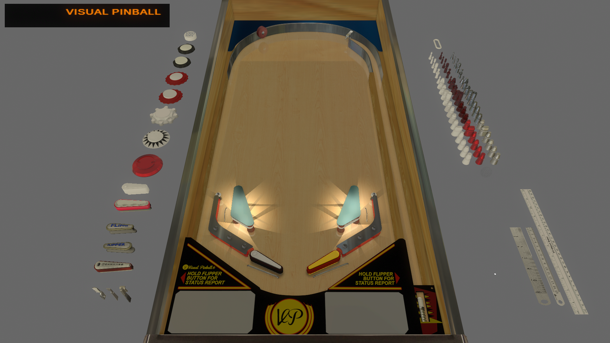

<p align="center">
  
</p>

<h3 align="center">Game Vault · Visual Pinball</h3>

<p align="center">
  <b>Visual Pinball X tables on your Xbox, with the controller.</b><br>
  Visual Pinball X with PinMAME for <a href="https://github.com/skitzellez/xbox-game-vault">Game Vault</a> on <b>Xbox Series X|S</b> in Dev Mode:
  pick a table in Game Vault and it plays here, then you are back in Game Vault.
</p>

<!-- gv-buttons:start -->
<p align="center">
  <a href="https://github.com/skitzellez/VPinball-GameVault/releases/latest"></a>
  &nbsp;
  <a href="https://github.com/skitzellez/xbox-game-vault"></a>
  &nbsp;
  <a href="https://discord.gg/RmhhWgguvw"></a>
  &nbsp;
  <a href="https://www.patreon.com/Skitzelles"></a>
</p>
<!-- gv-buttons:end -->

<p align="center">
  
</p>

## 🎮 What it is

[Visual Pinball X](https://github.com/vpinball/vpinball) is a free pinball simulator. Its tables are `.vpx` files, and fans have
recreated hundreds of real machines and made many originals. Tables of real machines run the machine's own program in
[PinMAME](https://github.com/vpinball/pinmame). This app is Visual Pinball X standalone, made for Xbox Series X|S in Dev Mode.

**No tables or ROMs are included.** Bring your own, and only play what you have the right to play.

## 1️⃣ 2️⃣ 3️⃣ How to play

| | |
|---|---|
| **1** | Install [Game Vault](https://github.com/skitzellez/xbox-game-vault). Its setup adds this app, or press RT in Game Vault to add it with your phone. |
| **2** | Put your `.vpx` tables on your games USB drive, for example in a `Pinball` folder. A table of a real machine needs that machine's ROM (`.zip`, don't unpack it) in a `pinmame\roms` folder next to the table. |
| **3** | Open the **PINBALL** shelf in Game Vault and press A. |

```
Pinball\
  Some Table.vpx
  Some Table.directb2s   (its backglass, optional)
  pinmame\
    roms\
      <the machine's rom>.zip
```

## 🕹️ Controls

| Controller | On the table |
|---|---|
| LT / RT | Left / right flipper |
| A | Launch the ball |
| Right stick | Pull the plunger back, let go to launch |
| Left stick | Nudge the table |
| LB / RB | Magna-save buttons |
| Y | Insert a coin |
| B | Start a game |
| D-pad | The machine's service menu |
| Menu | Visual Pinball's menu |
| View | Quit, back to Game Vault |

## 📜 Credits and licence

- Visual Pinball X: © the Visual Pinball team and contributors. GPLv3+, with older parts under the original licence: see [docs/license.txt](docs/license.txt).
- PinMAME, the VBScript engine (from Wine), bgfx, FFmpeg, FreeImage and the other libraries keep their own licences; the app carries them all in its `licenses` folder.
- Xbox port: Skitzelles, in `xbox/` and the changes marked "Game Vault" in the source.

This is a modified version of Visual Pinball X, not made or supported by the Visual Pinball team. Please report problems with this app to Game Vault, not to them.

<!-- gv-family:start -->
## 🎮 The Game Vault family

Game Vault is one launcher plus emulators built to work with it. **Install [Game Vault](https://github.com/skitzellez/xbox-game-vault) and it sets these up for you**; press **RT** in Game Vault to update them all.

**Apps**

| Project | What it is | Runs on |
|---|---|---|
| [Game Vault](https://github.com/skitzellez/xbox-game-vault) | The launcher: plug in a USB drive, pick a game, play. Sets up everything below by itself. | Xbox Series X&#124;S |
| [Game Vault for Android](https://github.com/skitzellez/game-vault-android) | The same game library for phones, tablets and Android TV (beta). | Android |
| [Game Vault for iPhone](https://github.com/skitzellez/game-vault-ios) | The Game Vault look on iPhone (early test). | iPhone |

**Emulators built for Game Vault**

| Project | What it is | Runs on |
|---|---|---|
| [xemu for Xbox Dev Mode](https://github.com/skitzellez/xemu-uwp) | Original Xbox | Xbox Series X&#124;S |
| [Xenia for Game Vault](https://github.com/skitzellez/Xenia-GameVault) | Xbox 360 | Xbox Series X&#124;S |
| [XBSX2 for Game Vault](https://github.com/skitzellez/XBSX2-GameVault) | PlayStation 2 | Xbox Series X&#124;S |
| [Dolphin for Game Vault](https://github.com/skitzellez/Dolphin-GameVault) | GameCube and Wii | Xbox Series X&#124;S |
| [Game Vault · Wii U (Cemu)](https://github.com/skitzellez/Cemu-GameVault) | Wii U | Xbox Series X&#124;S |
| [RPCS3 for Game Vault](https://github.com/skitzellez/RPCS3-GameVault) | PlayStation 3 | Xbox Series X&#124;S |
| [Game Vault · PS Vita](https://github.com/skitzellez/Vita-GameVault) | PlayStation Vita (Vitox / Vita3K) | Xbox Series X&#124;S |
| [Flycast for Game Vault](https://github.com/skitzellez/Flycast-GameVault) | Sega NAOMI, NAOMI 2 and Atomiswave arcade | Xbox Series X&#124;S |
| [RetroArch for Game Vault](https://github.com/skitzellez/RetroArch-GameVault) | PlayStation, Dreamcast, arcade, classic consoles and computers (80+ systems) | Xbox Series X&#124;S, Android |
| [Game Vault · Flash](https://github.com/skitzellez/Flash-GameVault) | Flash games | Xbox Series X&#124;S |
| [Game Vault · OpenBOR](https://github.com/skitzellez/OpenBOR-GameVault) | OpenBOR beat 'em up games | Xbox Series X&#124;S |
| [**Game Vault · Visual Pinball**](https://github.com/skitzellez/VPinball-GameVault) 📍 *you are here* | Visual Pinball X pinball tables (with PinMAME) | Xbox Series X&#124;S |
| [Gambatte for Game Vault](https://github.com/skitzellez/Gambatte-GameVault) | Game Boy link cable in online rooms | Xbox Series X&#124;S, Android |
| [X1 BOX for Game Vault](https://github.com/skitzellez/x1box-gamevault) | Original Xbox | Android |

**Extras**

| Project | What it is | Runs on |
|---|---|---|
| [Free games](https://github.com/skitzellez/game-vault-free-games) | Freeware and shareware for the FREE GAMES tab | Game Vault |
| [Game Vault · Web](https://github.com/skitzellez/Web-GameVault) | Websites from the WEB menu, with the controller | Xbox Series X&#124;S |
| [Fallout 1in2 for Xbox](https://github.com/skitzellez/Fallout1in2-Xbox) | The original Fallout, made for the controller | Xbox Series X&#124;S |
| [Game Vault updates](https://github.com/skitzellez/game-vault-updates) | Update data Game Vault reads when it starts | Game Vault |

**💬 Help, news and bug reports:** the [Game Vault Discord](https://discord.gg/RmhhWgguvw) (or this repo's Issues).
Please don't take problems with these builds to the original emulator teams: they don't make or support them.
<!-- gv-family:end -->

## ❤️ Support the project

Game Vault and all of its emulator builds are free, and they always will be. No ads, no locked features,
nothing behind a paywall.

I build all of this with the help of an AI coding assistant (Claude), and that's what lets bug fixes and new features
come out so fast. If you'd like to help keep it going, you can support the project on
**[Patreon](https://www.patreon.com/Skitzelles)**. Every bit helps, and there's never any pressure.

**You help just as much by:**
- saying yes to **"Help make Game Vault better?"** in Game Vault. It sends crash reports, and that's how most fixes happen
- reporting problems on the **[Discord](https://discord.gg/RmhhWgguvw)**
- telling your friends and sharing your clips

Thank you for playing. 💙

